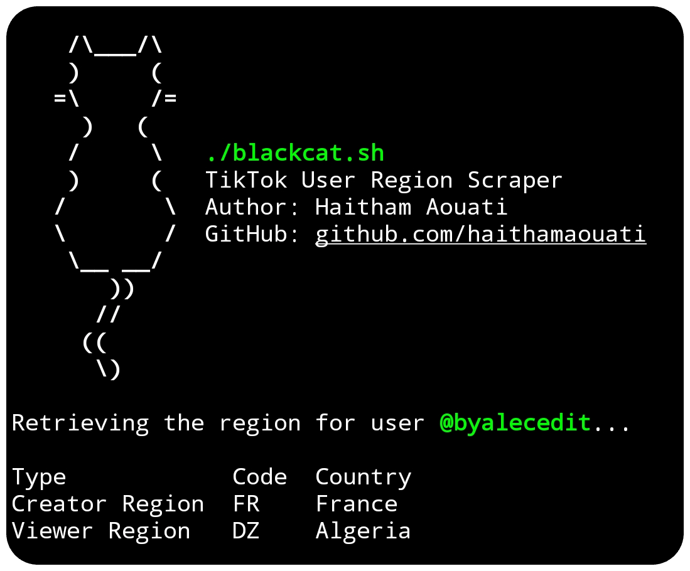

# BalckCat
**BalckCat** :black_cat: TikTok User Region Scraper

<p align="center">
  



## Install

To use the BalckCat script, follow these steps:

1. Clone the repository:

    ```
    git clone https://github.com/haithamaouati/BalckCat.git
    ```

2. Change to the BalckCat directory:

    ```
    cd BalckCat
    ```
    
3. Change the file modes
    ```
    chmod +x balckcat.sh
    ```
    
5. Run the script:

    ```
    ./balckcat.sh
    ```
## Usage

Usage: `./balckcat.sh -u, --url <url>`

## Dependencies
The script requires the following dependencies:

- **curl**: `pkg install curl - y`
- **jq**: `pkg install jq -y`
- **column**: `pkg install util-linux -y`

> [!IMPORTANT]  
> Make sure to install these **dependencies** before running the script.

## UserScript 

Usage Instructions for [Via](https://viayoo.com/en/) Browser

1. ​Open Via Browser.
2. ​Navigate to `Settings` > `Scripts`.
3. Enable `Enable scripts`.
4. Click `+` > `New Script`.
5. Paste the code provided above [userscript.js](https://raw.githubusercontent.com/haithamaouati/Eruda/main/eruda.user.js) and save.

Usage Instructions for [Soul](https://play.google.com/store/apps/details?id=com.mycompany.app.soulbrowser&hl=en) Browser

1. ​Open Soul Browser.
2. ​Navigate to `Settings` > `Web content`.
3. Enable `Use UserScript` > `UserScript list`.
4. Click `+` > `Direct input`.
5. Paste the code provided above [userscript.js](https://raw.githubusercontent.com/haithamaouati/BlackCat/main/userscript.js) and save.

Import script from URL:
```
https://raw.githubusercontent.com/haithamaouati/BlackCat/main/userscript.js
```

> [!NOTE]  
> The scraping technique relies on the current structure of the TikTok website, which may change.

> [!TIP]
> Wait 10 seconds before each attempt.

## Environment
- Tested on [Termux](https://termux.dev/en/)
- Tested on [Via](https://viayoo.com/en/) browser

## Disclaimer
>[!CAUTION]
>This Tool is only for educational purposes

> [!WARNING]
> We are not responsible for any misuse or damage caused by this program. use this tool at your own risk!

## Star History

[](https://www.star-history.com/#haithamaouati/BalckCat&type=date&legend=top-left)

#### Find this repository useful? ♥️
Support it by joining the [stargazers](https://github.com/haithamaouati/BalckCat/stargazers). ⭐

If you want to help even more, please spread the word — share the project on X, Reddit, or with your community so more people discover it.

And [follow me](https://github.com/haithamaouati) to keep up with future updates and projects. 🤩


## License

BalckCat is licensed under [WTFPL license](LICENSE).
